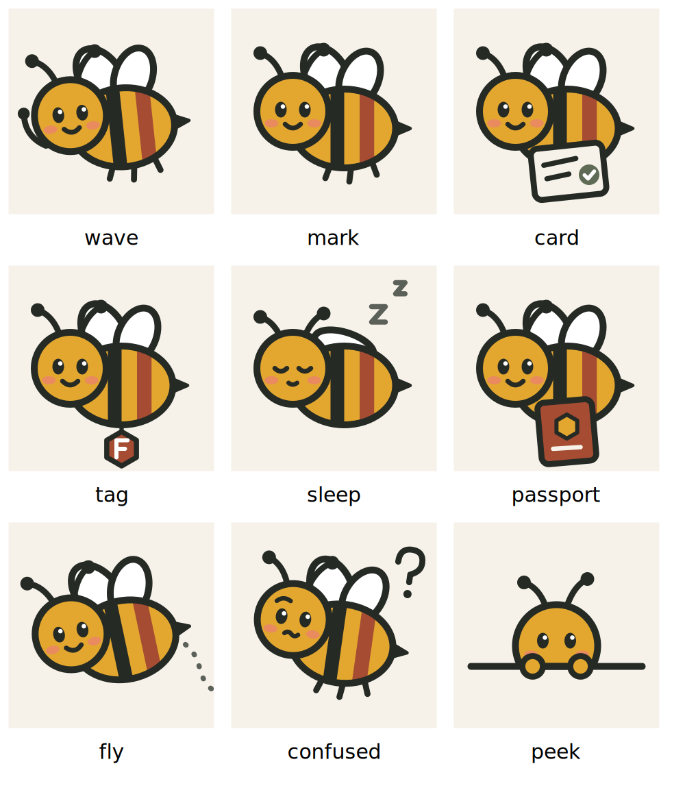
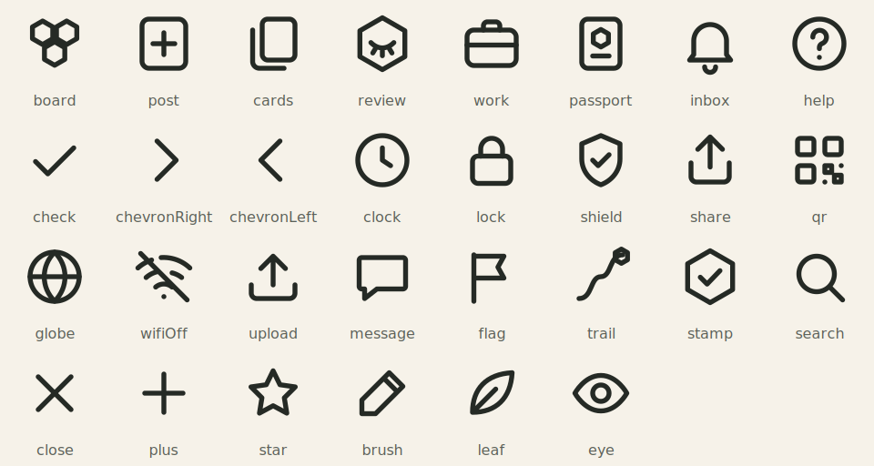

# Sajha Kaam brand: Mauri (मौरी) edition

Every choice below has a reason tied to what Sajha Kaam is (fair first jobs, blind hiring, proof that travels) or to the people using it (young Nepalis on low-cost Android phones, in two scripts). Where a choice rests on a platform guideline, the source is named.

## 1. Why a honey bee

| Bee fact | Product idea it carries |
|---|---|
| *Sajha* (साझा) means "shared"; a hive is a shared home where each worker bee works for all | The name itself |
| The waggle dance tells nest-mates exactly where the flowers are (direction + distance) | The Kaam Card: a clear "done when", not a vague ask |
| A forager is valued for what she brings back | Blind review: judged on the work, not the name (used as a metaphor, not a biology claim) |
| Honeycomb cells are filled one by one | Kaam Path and Passport stamps: one cell per confirmed job |
| Nepal has native honey-bee species, including the Himalayan giant honey bee, and beekeeping is a real livelihood at home | A career built from home, without migrating |

**Name:** Mauri (मौरी), the everyday Nepali word for honey bee. A native speaker must still confirm the name and every Mauri line (`NEPALI_REVIEW.md`).

## 2. Drawing style and why it does not look "AI-made"

Template and AI-generated apps share a look: purple-to-blue gradients, glassy cards, glowing accents, 3D blob mascots, emoji as icons, a thin coloured stripe on the left of "highlighted" cards. We avoid every one of those on purpose:

- **Flat fill + one ink outline** (4 units in a 120 box), in the spirit of Mithila painting from Janakpur and Nepali truck art: bold outline, flat colour. It is local, it reads at 24 px, and it is pure vector (no image bytes, a few KB of SVG per pose).
- **Her signature is a brick stripe.** Real bees are black and yellow; Mauri's rear stripe is the brand brick. You can tell her from a stock bee at a glance.
- **No gradients, no shadows, no glass.** Depth comes from a 2 px darker "lip" under primary buttons and the ticket notches on cards.
- **Highlights are content-shaped, not decorated:** the "next step" card is an *ink* ticket with honey text; the board card is a *ticket* with a perforation and a honey price stub; Passport is a *booklet* with a darker spine. Each highlight looks like the real-world object it stands for.

One geometry file (`mobile/src/components/brand/geometry.ts`) feeds the in-app bee, the launcher icon, the splash and this sheet, so they never drift apart.

### Poses and where each is allowed

| Pose | Used for |
|---|---|
| `wave` | Language choice, welcome, Help |
| `peek` | Empty lists |
| `confused` | Errors (head tilt, no distress) |
| `sleep` | Offline banner, Lite Mode |
| `card` | A Kaam Card really posted |
| `tag` | Application really sent ("you'll appear as a letter") |
| `passport` | Work Passport cover |
| `fly` | Beside the Kaam Path |
| `mark` | Logo, icon, splash |

**Never:** on Blind Review scoring controls, next to a decision (pick, reveal, reject), or as a reward. Mauri guides; she never judges or speaks for the system.

## 3. Colour

Colours come from Nepali materials, not from a UI kit:

| Token | Hex | Source | Rule |
|---|---|---|---|
| `brick` | `#A64C32` | Newari terracotta (Bhaktapur, Patan) | Primary action. One brick button per screen |
| `paper` | `#F6F2E9` | Lokta paper | App background (warmer than the usual grey) |
| `ink` | `#252A25` | Soot ink, green-black | Text, outlines, the "next step" ticket |
| `honey` | `#E3A72F` | Mauri | Accent only: path cells, stamps, active-tab hex |
| `honeyWash` | `#F8EBCB` | — | Highlighted surfaces (price stub, Help card), always with ink text |
| `sage` | `#5F6B55` | — | Means "confirmed / done". Never decorative, so it keeps its meaning |
| `blush` | `#E98A5F` | — | Inside the mascot only |

Contrast: body text is ink on paper/white/honeyWash (well above WCAG AA 4.5:1); white on brick for buttons. State is never shown by colour alone: chips get a check, the active tab gets a hexagon, steps get a check or a dot.

## 4. Type

- Inter (Latin) + Noto Sans Devanagari, chosen per string automatically.
- Only 400 and 600 ship: smaller APK, one weight system ("bold" = semibold).
- Devanagari gets +1 px and a taller line height (1.5): the headline stroke (shirorekha) makes it look smaller and taller at equal size.
- Latin headings get slight negative tracking. Nepali never gets letter-spacing or ALL-CAPS. The English name may appear as a small-caps label under the Nepali one: the Nepali name always leads.

## 5. Icons

30 icons on one 24 px grid, 1.8 stroke, round caps (`Icon.tsx`). They replace `@expo/vector-icons`, which bundles whole icon fonts. Icons that stand for *our* ideas (board, blind review, passport, stamp, Kaam Path) are built on the hexagon, so the brand lives in the icons. Symbol glyphs such as ☐ ✗ ✓ are drawn as vectors because many Android fonts lack them.

## 6. Motion

| Use | Duration | Curve |
|---|---|---|
| Press feedback (scale to 97 %) | spring, no bounce | critically damped |
| Content arriving (fade + 8 px rise) | 220 ms, stagger ≤ 180 ms | `cubic-bezier(0.05, 0.7, 0.1, 1)` (Material 3 "emphasized decelerate" style) |
| Tab icon hex, success cell | 200–260 ms | same |
| Screen push | 260 ms | platform |
| Splash sequence | ≈ 1.0 s total, tap to skip | — |

The **splash** continues the native splash with the identical picture (no jump), then: wing beats and lift-off, a short waggle run, the wordmark rising in, and a fade out once the app is ready. Google recommends an animated splash icon stay at or under 1,000 ms; we match that, and never hold the user beyond what loading needs (700 ms minimum so the bee is not a flicker).

Motion always explains something (arrived, pressed, confirmed). It is fully off with the phone's reduce-motion setting and in **Lite Mode**. There is no confetti, no looping attention-grabbers on decision screens, and no countdowns.

## 7. Logo

- **Mark:** Mauri on a brick tile with the sage "confirmed" hexagon at the bottom-right.
- **Lockups:** mark only (`Logo`), horizontal (`Brand`: mark + साझा काम + SAJHA KAAM + tagline), stacked (`BrandStacked`). The wordmark is live text, not an image.
- **Minimum size:** 24 px for the mark. **Clear space:** one quarter of the mark's width on every side.
- **Don't:** recolour the bee, add a gradient or shadow, put the mark on a busy photo, or change the stripe order.
- **Adaptive icon:** the bee sits inside the central safe zone and survives circle, squircle and rounded-square masks. The monochrome version (Android 13 themed icons) is a silhouette with the face and stripes cut out.

Regenerate everything with `npm run icons` (writes `assets/brand/*.svg`, renders the PNGs).

## 8. Assets in this folder

- `brand/mauri-poses.png`: all poses
- `brand/icon-set.png`: the icon set
- `brand/feature-graphic-1024x500.png` (+ `.svg`): store feature graphic
